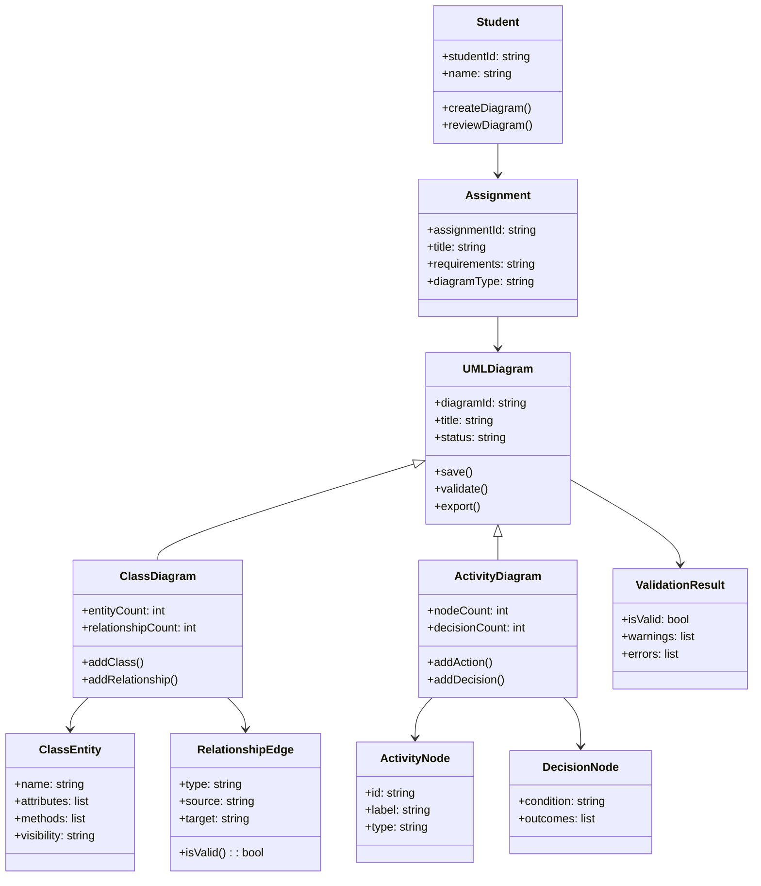
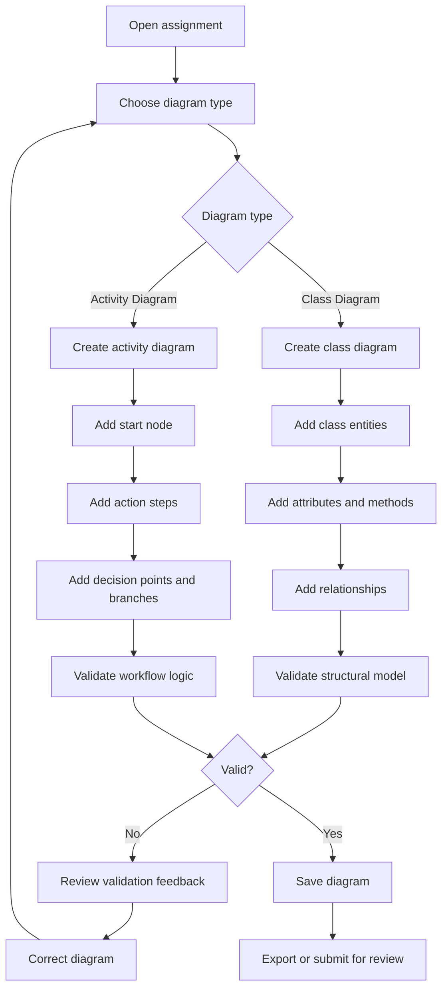

# UML Design Documents for CIS 285 Lab 7

## 1. Design Overview

This document provides the UML design artifacts for the Hybrid Consolidated Architecture. It includes the core structural model for class definitions and the workflow process model for diagram creation and validation.

---

## 2. UML Class Diagram Structure

### Class Diagram Explanation

The model is designed to represent the core UML building blocks for the lab assignment:

- Student creates or reviews diagrams in the context of an Assignment.
- Assignment defines the problem scenario and expected modeling tasks.
- UMLDiagram is the abstract base type for all diagram types.
- ClassDiagram captures structural entities, attributes, and relationships.
- ActivityDiagram captures process flow, decisions, and action sequencing.
- ValidationResult records whether the diagram satisfies the assignment requirements and notes corrective feedback.

---

## 3. UML Activity Diagram Workflow

### Activity Diagram Explanation

This workflow reflects the practical student process for both UML contexts:

1. The student starts with an assignment.
2. The student chooses the correct diagram type.
3. The student adds the required elements for that diagram.
4. The system validates the structure or workflow.
5. If problems are found, the user revises the diagram.
6. If the model passes validation, the student saves and exports the result.

---

## 4. Design Relationship to Requirements

This design supports the project requirements by ensuring that:

- class diagrams can capture entities, attributes, and relationships
- activity diagrams can capture actions, decisions, and outcomes
- early validation is available to catch incomplete or ambiguous models
- users can revise diagrams before finalizing them
- the system remains maintainable and extensible for additional UML views

---

## 5. Final Design Assessment

The UML class and activity models reflect the hybrid architecture in an implementable way. They align with the lab’s educational goals while preserving a robust software structure for future growth, validation, and review.
